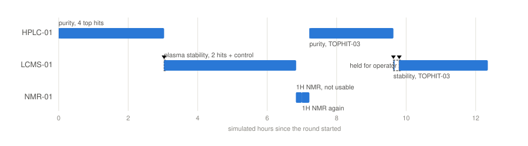
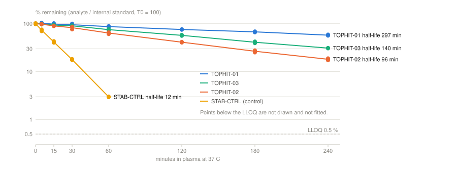
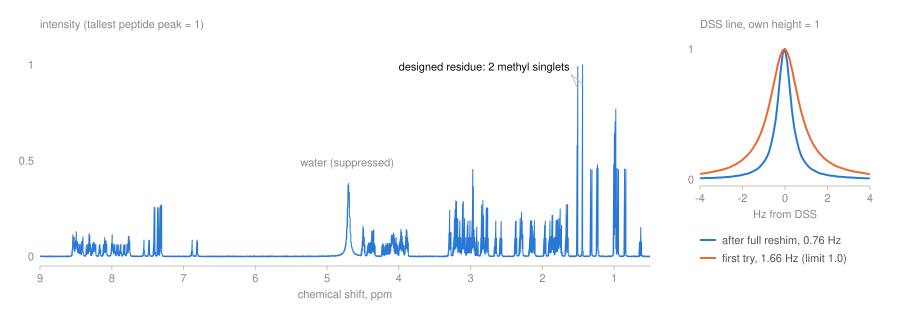

# agentic-lcms-hplc-nmr

Agentic control of LC-MS, HPLC and NMR through the vendor software, shown in simulation.

A planning agent should be able to say "measure these samples with this approved method" and get back a
result it can trust, without touching pumps, gradients or pulse programs. This repository is that layer for
three analytical instruments, with simulators standing in for the instruments and their software.



## The approach

1. **The vendor software stays in charge.** OpenLab CDS, SCIEX OS and TopSpin keep control of acquisition,
   interlocks and raw data. The agent works through them, never around them.
2. **Use the most supported interface the installed system offers.** In order: the vendor's API; the vendor's
   documented queue or file interface for a LIMS; a lab standard if the instrument ships one (SiLA 2, OPC UA
   LADS); only then the operator screen, through browser or desktop UI automation.
3. **Give the agent a few tools, not the instrument.** Five MCP tools: `list_instruments`,
   `request_measurement`, `get_measurement`, `cancel_measurement`, `read_ledger`. The agent names an approved
   method version; it never sends instrument parameters.
4. **Make every request idempotent and findable.** The agent's `request_id` goes into a field the vendor
   software stores (batch name, command file name, experiment title). Asking twice returns the same request.
   After a lost reply, the gateway searches the vendor's own queue and history for it.
5. **Never retry blind.** A lost reply puts the request in `unknown` and holds the instrument. Found once:
   monitoring resumes. Not found within the grace period, or found twice: a person decides (adopt, resubmit
   or abandon), and the decision is recorded under their name. The agent has no tool for this.
6. **Record every call that changes an instrument,** before the call is made, in a hash-chained ledger.
7. **A completed run and a usable result are two decisions.** Each approved method version carries its
   acceptance criteria. Only results that pass them feed the next design round.

## How each instrument is reached

| | HPLC purity | LC-MS plasma stability | NMR structure |
|---|---|---|---|
| Vendor software | Agilent OpenLab CDS | SCIEX OS | Bruker TopSpin 5 with SpinPilot |
| Interface | Sample Scheduler for OpenLab: LIMS XML commands in a watched folder | SCIEX OS Control API; Data API for .wiff2 | SpinPilot Python API; TopSpin acquires |
| Unit of work | one XML command | one batch | one experiment per tube |
| Where the request_id lives | command file and sequence name | batch name | experiment title |
| After a lost reply, look in | commands folder, trash folder, analysis table | queue and acquisition history | experiment list |
| Adapter | [openlab_scheduler.py](src/lab_gateway/adapters/openlab_scheduler.py) | [sciex_os.py](src/lab_gateway/adapters/sciex_os.py) | [spinpilot.py](src/lab_gateway/adapters/spinpilot.py) |

The interfaces are the vendors' documented routes. Their exact call names and XML schema are not public:
the SCIEX OS APIs come through SCIEX's API program, the SpinPilot API is documented in the TopSpin help, and
the Sample Scheduler schema is in its Command Guide. So each adapter talks to a small client interface
defined here, and binding it to the licensed library is an install step. The simulators implement the same
interfaces. On TopSpin 4 without SpinPilot, the NMR adapter can run TopSpin commands (`sx`, `lock`, `atma`,
`topshim`, `rga`, `zg`, `efp`, `apk`) through TopSpin's Python 3 interface instead.

**The operator screen, as a last resort** ([ui_fallback.py](src/lab_gateway/adapters/ui_fallback.py)):
fields addressed by their labels (Playwright `get_by_label`, or Windows UI Automation names), every field read
back before anything is pressed, acceptance confirmed by finding the request_id in the instrument's own queue
view. If the screen cannot confirm acceptance reliably, the adapter prepares the run and leaves Start to the
operator.

## One round, in simulation

Four top hits go through purity, plasma stability and NMR. Four things go wrong on purpose.

| Step | What happened |
|---|---|
| HPLC purity, 4 hits | Vial P1-A3 holds another peptide's tube: barcode mismatch, not injected, reported. TOPHIT-04 at 86.9 % is held back. |
| LC-MS stability | The planner first names a draft method version: refused before anything is sent. Then the reply from SCIEX OS is lost after the batch was accepted: the gateway finds the batch in the queue and keeps monitoring. Nothing runs twice. |
| NMR on the most stable hit | Finished, but the DSS line is 1.66 Hz against a 1.0 Hz limit, so not usable. Asked again with a full reshim: 0.76 Hz, and the designed residue's two methyl singlets are there. |
| TOPHIT-03 after the vial fix | Purity 95.4 %. Its stability batch never reaches SCIEX OS: `unknown`, then `needs_operator` after 10 minutes. A second LC-MS request is refused while the instrument is held. The operator checks SCIEX OS and resubmits. |
| Decision | Build on TOPHIT-01 (plasma half-life about 300 min, structure confirmed by NMR); NMR for TOPHIT-03 next. |





The full run page, with the HPLC chromatograms, every acceptance check, the ledger and all 34 tool calls, is
[docs/demo/index.html](docs/demo/index.html) (open it in a browser).

## Run it

```bash
uv sync
uv run pytest
uv run lab-demo --out runs/demo
uv run python -m lab_gateway.report runs/demo docs/demo
```

The tests (37, a few seconds) cover the checks before submission, both lost-reply branches, a gateway restart
mid-request, the barcode rule, dead plasma and carryover failures, the shim and lock failures, the UI
fallback, and the whole round over a real MCP stdio connection.

Point any MCP client at the server, for example in a Claude Desktop or Claude Code config:

```json
{"mcpServers": {"lab-gateway": {"command": "uv",
  "args": ["run", "--directory", "/path/to/agentic-lcms-hplc-nmr", "lab-gateway-mcp"],
  "env": {"LAB_GATEWAY_RUN_DIR": "runs/agent", "LAB_GATEWAY_SCENARIO": "demo"}}}}
```

Operator decisions go through a separate command:

```bash
uv run lab-operator pending --run-dir runs/demo
uv run lab-operator decide --run-dir runs/demo --request-id ID --decision resubmit --operator NAME --note "what you checked"
```

## Layout

```
src/lab_gateway/
  mcp_server.py          the five tools
  gateway.py             checks, reservation, ledger, lost replies, operator decisions
  evaluate.py            acceptance criteria per method: the QC gate
  analysis.py            integration, tailing, plate count, half-life fit, NMR processing
  ledger.py              hash-chained record of instrument-changing calls
  approved_methods.json  method versions, vendor method fingerprints, acceptance criteria
  adapters/              Sample Scheduler, SCIEX OS, SpinPilot, operator screen
  sim/                   the simulated vendor systems and what is physically in each vial
  campaign.py            the demo round, driven over MCP
tests/
docs/demo/               the run page and figures
```

## Before a real instrument

Run the same reference samples through an expert-operated sequence and through the gateway. Compare sample
identity, method version, raw data completeness, and the method's own measures: HPLC retention time
repeatability, LC-MS internal standard response and carryover, NMR reference linewidth and signal-to-noise.
Commission the barcode mismatch path on a system with a reader, and check the XML against the Command Guide
of the installed Sample Scheduler version.

Everything here is simulated. Method names, timings and peptides are illustrative, and peptides carry numbers
only.
